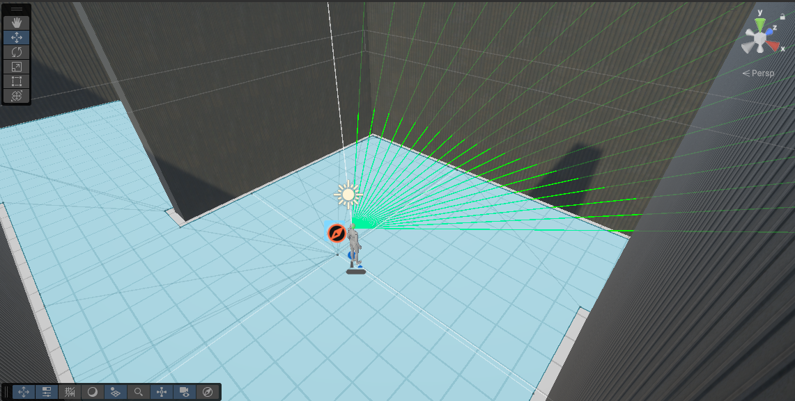
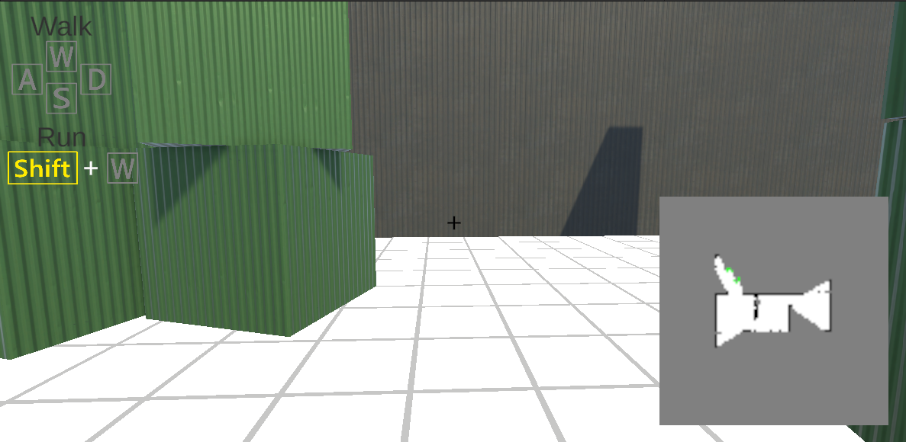

# Enemy-Search-Agent
Enemy search AI for Unity using Raycast

## Demo

## 概要

Unityで製作した鬼ごっこの鬼エージェントです。

巡回AIのようにあらかじめ設定された巡回ルートに依存せず、様々なマップに対応できるエージェントの構築に興味を持ち開発しています。

現在は、Raycastを用いて周囲の環境を探知し、その情報をもとにマップを生成する機能を実装しています。今後は取得した環境情報を活用し、自律的に探索地点を決定して行動できる探索アルゴリズムの実装を目標としています。

## 開発背景

本プロジェクトは、Unityの開発を学ぶために鬼ごっこゲームを制作したことから始まりました。

当初は、プレイヤーが床のグリッドを指定して壁を設置し、それを回避しながら鬼エージェントがプレイヤーを追跡するシンプルなゲームを想定していました。しかし開発を進める中で、鬼エージェントをはじめとするNPC（プレイヤーが操作しないキャラクター）の行動を決定する仕組みには、多くの要素が関わることを知り、その奥深さに興味を持ちました。

一般的なNPCは、あらかじめ設定した巡回地点やマップ情報を利用して行動することがあります。一方で、私は「事前にマップの情報を持たないNPCが、自ら周囲の環境を認識し、探索しながら行動を決定すること」に興味を持ちました。

大学で研究活動に取り組むにあたり、このテーマをさらに発展させたいと考え、本プロジェクトではRaycastを用いた環境認識とマップ生成を基盤とした、自律的な探索エージェントの開発に取り組んでいます。

## 実装済み

- プレイヤーによる壁の設置機能
- NavMeshによる移動
- RayCastを用いた周囲環境の探知
- 障害物の検知
- プレイヤー発見判定
- 探知結果を利用したマップ生成

### 周囲環境の探知

### マップ生成

**現在の仕様**

探索地点を決定するアルゴリズムは未実装です。
そのため、鬼エージェントは自律的な探索は行わず、プレイヤーを視界内で検知した場合にのみ追跡を開始します。

## 今後実装予定

- 探知結果から探索優先度を算出し、探索地点を決定するアルゴリズム

## 興味・今後挑戦したいこと

現在は探索アルゴリズムの開発を中心に取り組んでいますが、将来的には鬼エージェントのモーションやアニメーション制御にも挑戦し、より自然で人間らしい挙動を実現したいと考えています。

## 現状の課題

本プロジェクトは、Unityを用いた初めての本格的な開発として取り組んでいるものです。

開発当初は、マップ更新のたびに Texture2D.Apply() を呼び出していたため、GPUへのテクスチャ転送が頻繁に発生し、フレームレートが大きく低下していました。

Unity Profilerを用いて処理を分析した結果、テクスチャ更新処理がボトルネックの一つであることを確認し、Apply() を1フレームに1回だけ実行するよう改善しました。その結果、プレイ可能なフレームレートまで改善することができました。

今後も、探索アルゴリズムの改善や更新頻度の見直しなどを通して、さらなるパフォーマンス改善のための最適化も学んでいきたいです。

## 使用技術

- Unity6
- C#
- NavMesh
- RayCast
